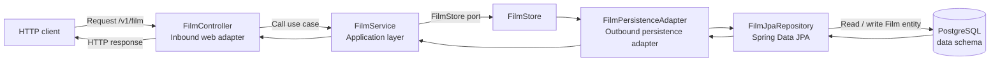

# Repository guide for AI agents

## Project at a glance

HdH Backend is a Java 21 / Spring Boot REST API for a film and series catalog. It is a modular monolith under `org.home.backend`; the Angular frontend is maintained separately and is not served or built here.

## Architecture and source map

- `src/main/java/org/home/backend/BackendApplication.java` is the Spring Boot entry point.
- `src/main/java/org/home/backend/catalog/film/` contains the film feature. Its web controller calls `FilmService`, which depends on the `FilmStore` output port; `FilmPersistenceAdapter` implements that port using `FilmJpaRepository`.
- `src/main/java/org/home/backend/catalog/series/` contains the `Serie` and `Episode` JPA entities and their Spring Data repositories. No series or episode HTTP controllers currently exist.
- `src/main/java/org/home/backend/config/` configures CORS and stateless Spring Security JWT resource-server authentication. `/v1/**` requires a token; the actuator health endpoint is public.
- `src/main/java/org/home/backend/common/web/` contains the RFC 9457 Problem Details error handling used by MVC and authentication failures.
- `src/main/resources/application.properties` contains environment-backed application and database settings.
- `src/main/resources/db/migration/` contains Flyway schema migrations. The schema is `data`.
- `src/test/java/` contains the Spring Boot test suite.

Keep feature code within its module. For new web behavior, follow the existing film feature's adapter/application/port/persistence separation where appropriate; do not make application services depend directly on Spring Data repositories.

## Architectural pattern and request flow

The repository is a **modular monolith**. Within the film feature, the code follows a **ports-and-adapters (hexagonal) pattern**:

- The inbound web adapter (`FilmController`) translates HTTP requests into calls to the application service.
- The application layer (`FilmService`) contains film use-case behavior and depends on the `FilmStore` output port, not on a database technology.
- The outbound persistence adapter (`FilmPersistenceAdapter`) implements `FilmStore` and delegates storage operations to the Spring Data `FilmJpaRepository`.
- The repository uses the `Film` JPA entity to read and write PostgreSQL data.

Typical film request and response flow:

The `FilmStore` interface is the boundary that keeps application behavior independent of Spring Data. Preserve this direction when extending the film feature. The series module currently has entities and repositories only, so the film request flow does not apply to series or episodes until application and web layers are introduced.

## Existing HTTP API

The film API is rooted at `/v1`:

- `GET /v1/film` lists films; currently returns `204 No Content` when the list is empty.
- `GET /v1/film/{id}` fetches one film; returns `404 Not Found` when no film is found.
- `POST /v1/film` creates or updates a film, selected by whether its ID is zero.
- `DELETE /v1/film/{id}` deletes a film.

All `/v1/**` requests require a valid JWT bearer token. Configure `OIDC_ISSUER_URI`, `OIDC_JWKS_URI`, and `OIDC_AUDIENCE`; browser origins are controlled by `APP_CORS_ALLOWED_ORIGINS`. Errors use RFC 9457 Problem Details for 400, 401, 403, 404, 405, 415, and 500. Missing films return 404; an empty list remains 204. CORS is not an authentication mechanism.

The Postman collection is `postman/HDH Backend.postman_collection.json`. Security and MVC tests can run without PostgreSQL or an OIDC provider with `.\mvnw.cmd -Dtest=JwtAudienceValidatorTests,ApiSecurityIntegrationTests test`.

The series and episode repositories are persistence-only at present; do not document them as public endpoints unless controllers are added.

## Build and test

Use the Maven wrapper so the project uses its configured Maven version:

- Windows build: `.\mvnw.cmd -DskipTests package`
- Build and run tests: `.\mvnw.cmd test`
- Unix-like build: `./mvnw -DskipTests package`
- Unix-like tests: `./mvnw test`

The test suite starts the Spring application context. `BackendApplicationTests` uses Testcontainers to create and remove an isolated PostgreSQL 17 database; Docker must be running for `.\mvnw.cmd test`. Security-only tests can run without Docker using `.\mvnw.cmd -Dtest=JwtAudienceValidatorTests,ApiSecurityIntegrationTests test`.

## Data and configuration

- PostgreSQL is the runtime database. Use `docker compose --env-file env/dev/.env up --build -d` for the documented local setup.
- Hibernate is configured to validate the database schema, not create or update it.
- Make schema changes through a new Flyway migration; do not edit an already-applied migration.
- Connection and server settings come from environment variables. Never add credentials or real secrets to source control; `env/dev/.env` is a local-development template.
- OIDC issuer, JWKS endpoint, and API audience are deployment configuration. Angular is a public client and should use OIDC Authorization Code with PKCE; do not add client secrets to frontend code.
- CORS restricts browser origins but does not replace bearer-token authentication.
- Preserve the existing `/v1` API prefix and the `data` database schema unless a task explicitly changes them.

## Change guidance

- Read the existing feature and its tests before changing behavior; add or update tests for behavior changes.
- Keep changes scoped to the requested feature and preserve established package naming and formatting.
- Update `README.md` when developer setup, configuration, or public API behavior changes.
- When creating an implementation plan for repository work, write it in English and save it under `docs/plan/` using `YYYY-MM-DD-short-task.md`; use a title starting with the date and a concise task summary. Record the scope, implementation decisions, tests, and validation results; update the plan if implementation changes materially.
- Do not add frontend code to this repository; it is a separate application.
