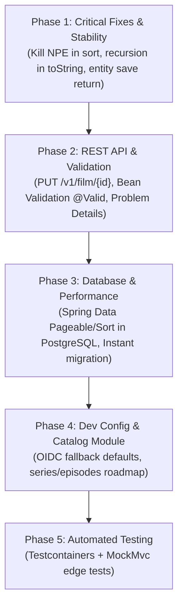

# 2026-10-24 Backend Remediation Plan

## Summary

This remediation plan addresses the architectural issues, critical runtime bugs, REST convention inconsistencies, and database optimization opportunities identified in the Java 21 / Spring Boot application (`backend/`).

---

## Phasing & Dependencies



---

## Phase 1: Critical Fixes & Runtime Stability

### 1.1 Fix Comparator NullPointerException in `FilmService`
- **Location**: [`FilmService.java`](file:///d:/Projects/RipPerC_backend/backend/src/main/java/org/home/backend/catalog/film/application/FilmService.java#L20-L24)
- **Defect**: `Comparator.comparingInt(Film::getYear)` unboxes `Integer` to primitive `int`. When any entity in the database contains a `null` year (or title), the unboxing throws a `NullPointerException` causing an unexpected HTTP 500.
- **Decision & Fix**: Implement a null-safe comparator:
  ```java
  Comparator.comparing(Film::getYear, Comparator.nullsLast(Comparator.naturalOrder()))
            .thenComparing(Film::getTitle, Comparator.nullsLast(Comparator.naturalOrder()))
  ```

### 1.2 Prevent Infinite Recursion (`StackOverflowError`) in `Serie` and `Episode`
- **Location**: [`Serie.java`](file:///d:/Projects/RipPerC_backend/backend/src/main/java/org/home/backend/catalog/series/domain/Serie.java#L95-L103) & [`Episode.java`](file:///d:/Projects/RipPerC_backend/backend/src/main/java/org/home/backend/catalog/series/domain/Episode.java#L95-L103)
- **Defect**: Bidirectional JPA mapping where `Serie.toString()` prints `listEpisodes` and `Episode.toString()` prints `serie`. Any logging or debugger invocation causes mutual recursive calls leading to `StackOverflowError`.
- **Decision & Fix**:
  - Exclude the reciprocal reference from `toString()`:
    ```java
    // In Serie.java
    @ToString(exclude = "listEpisodes")
    // In Episode.java
    @ToString(exclude = "serie")
    ```
  - Implement robust `equals()` and `hashCode()` based on business identity or persistent ID without accessing uninitialized lazy proxies.

### 1.3 Return Persisted Entity from `FilmService.createOrUpdateFilm`
- **Location**: [`FilmService.java`](file:///d:/Projects/RipPerC_backend/backend/src/main/java/org/home/backend/catalog/film/application/FilmService.java#L31-L46) & [`FilmController.java`](file:///d:/Projects/RipPerC_backend/backend/src/main/java/org/home/backend/catalog/film/adapter/in/web/FilmController.java#L40-L48)
- **Defect**: `createOrUpdateFilm` has a `void` return type, discarding the instance returned by `filmStore.save(film)`. `FilmController` returns the pre-save entity instance in the response body. If the sequence allocates a new ID or Hibernate populates audit fields, they may not be reflected in the HTTP response.
- **Decision & Fix**:
  - Update `FilmService.createOrUpdateFilm` to return `Film`:
    ```java
    public Film createOrUpdateFilm(Film film) {
        ...
        return filmStore.save(film);
    }
    ```
  - In `FilmController`:
    ```java
    Film savedFilm = filmService.createOrUpdateFilm(film);
    return new ResponseEntity<>(savedFilm, newFilm ? HttpStatus.CREATED : HttpStatus.OK);
    ```

---

## Phase 2: REST API & Validation Modernization

### 2.1 Introduce Proper REST HTTP Methods (`PUT /v1/film/{id}`)
- **Location**: [`FilmController.java`](file:///d:/Projects/RipPerC_backend/backend/src/main/java/org/home/backend/catalog/film/adapter/in/web/FilmController.java#L40-L48)
- **Defect**: `POST /v1/film` is overloaded for both create and update operations based on whether `film.getId() == 0`, returning `202 ACCEPTED` for updates (violating standard HTTP semantics where 202 signifies deferred background processing).
- **Decision & Fix**:
  - Dedicate `POST /v1/film` strictly to creating new resources (`201 CREATED`).
  - Add `PUT /v1/film/{id}` for updating existing records (`200 OK` with updated resource, or `204 NO_CONTENT`).
  - Validate resource existence before updating; return `404 NOT_FOUND` via `ResourceNotFoundException` if the target ID does not exist.

### 2.2 Add Bean Validation (`@Valid`) to Request Payloads
- **Location**: [`backend/pom.xml`](file:///d:/Projects/RipPerC_backend/backend/pom.xml), [`Film.java`](file:///d:/Projects/RipPerC_backend/backend/src/main/java/org/home/backend/catalog/film/domain/Film.java), [`FilmController.java`](file:///d:/Projects/RipPerC_backend/backend/src/main/java/org/home/backend/catalog/film/adapter/in/web/FilmController.java)
- **Defect**: Zero validation on incoming JSON payloads. Clients can submit empty strings, negative years, or oversized texts without rejection.
- **Decision & Fix**:
  - Add `org.springframework.boot:spring-boot-starter-validation` dependency.
  - Annotate `Film` fields:
    ```java
    @NotBlank(message = "Title is required")
    @Size(max = 255)
    private String title;

    @NotNull(message = "Year is required")
    @Min(value = 1888, message = "Year must be 1888 or later")
    @Max(value = 2100, message = "Year must not exceed 2100")
    private Integer year;
    ```
  - Annotate `@RequestBody @Valid Film film` in controller methods.
  - Ensure `ApiExceptionHandler` handles `MethodArgumentNotValidException` producing RFC 9457 Problem Details with invalid field summaries.

---

## Phase 3: Database & Performance Optimizations

### 3.1 Server-Side Pagination and Ordering
- **Location**: [`FilmJpaRepository.java`](file:///d:/Projects/RipPerC_backend/backend/src/main/java/org/home/backend/catalog/film/adapter/out/persistence/FilmJpaRepository.java), [`FilmStore.java`](file:///d:/Projects/RipPerC_backend/backend/src/main/java/org/home/backend/catalog/film/application/port/out/FilmStore.java), [`FilmService.java`](file:///d:/Projects/RipPerC_backend/backend/src/main/java/org/home/backend/catalog/film/application/FilmService.java#L20-L25)
- **Defect**: `getAllFilms()` executes `findAll()` loading all table rows into memory and sorting in Java heap.
- **Decision & Fix**:
  - Update `FilmStore` with pagination support:
    ```java
    Page<Film> findAll(Pageable pageable);
    ```
  - In `FilmService`, delegate sorting and paging directly to PostgreSQL (`ORDER BY year ASC, title ASC LIMIT ? OFFSET ?`).
  - Add endpoint query parameters: `GET /v1/film?page=0&size=20&sort=year,asc`.

### 3.2 Java Time Migration (`java.time.Instant`)
- **Location**: [`Film.java`](file:///d:/Projects/RipPerC_backend/backend/src/main/java/org/home/backend/catalog/film/domain/Film.java#L38-L39)
- **Defect**: Uses legacy `java.util.Date` with `@Temporal(TemporalType.TIMESTAMP)`.
- **Decision & Fix**:
  - Migrate to `java.time.Instant`:
    ```java
    @CreationTimestamp
    @Column(name = "CREATION_DATE", updatable = false)
    private Instant creationDate;
    ```

---

## Phase 4: Local Developer Experience & Architecture Alignment

### 4.1 Provide Local Defaults for OIDC Environment Variables
- **Location**: [`application.properties`](file:///d:/Projects/RipPerC_backend/backend/src/main/resources/application.properties#L20-L22)
- **Defect**: Mandatory placeholder values without defaults cause `mvn spring-boot:run` to fail immediately on startup if `OIDC_ISSUER_URI`, `OIDC_JWKS_URI`, or `OIDC_AUDIENCE` are not exported in the shell.
- **Decision & Fix**:
  - Add fallback placeholders for local development:
    ```properties
    app.security.jwt.issuer-uri=${OIDC_ISSUER_URI:http://localhost:8080/realms/hdh}
    app.security.jwt.jwk-set-uri=${OIDC_JWKS_URI:http://localhost:8080/realms/hdh/protocol/openid-connect/certs}
    app.security.jwt.audience=${OIDC_AUDIENCE:hdh-api}
    ```

### 4.2 Series and Episode Module Roadmap
- **Location**: `org.home.backend.catalog.series`
- **Defect**: `SerieRepository` and `EpisodeRepository` exist without application services or web controllers.
- **Decision**:
  - Align with Ports-and-Adapters structure established in the film module: implement `SerieService`, `SerieStore`, `SeriePersistenceAdapter`, and `SerieController` when exposing series endpoints, or document them as pending domain models.

---

## Phase 5: Verification & Automated Tests

### 5.1 Test Cases
1. **Unit tests in `FilmServiceTest`**:
   - Verify sorting when `year` is `null`.
   - Verify sorting when `title` is `null`.
   - Verify that `createOrUpdateFilm` returns the persisted entity.
2. **Integration tests with `MockMvc`**:
   - `PUT /v1/film/{id}` returns `404 Not Found` for nonexistent IDs.
   - `POST /v1/film` with blank title or invalid year returns `400 Bad Request` with Problem Details.
   - `GET /v1/film` with pagination parameters returns correct page slices.
3. **Full Testcontainers validation**:
   - Run complete suite with Docker / PostgreSQL 17:
     ```powershell
     cd backend; .\mvnw.cmd test
     ```

---

## Acceptance Criteria

- [ ] All null-pointer risks in comparators are eliminated and tested.
- [ ] No circular recursion occurs when calling `toString()` on `Serie` and `Episode`.
- [ ] `POST /v1/film` and `PUT /v1/film/{id}` adhere to REST conventions and return proper HTTP status codes (`201`, `200`, `404`).
- [ ] Invalid request payloads are rejected with HTTP 400 Problem Details.
- [ ] Database pagination is active and query sorting is handled in PostgreSQL.
- [ ] Backend starts up locally without requiring manual OIDC environment exports.
