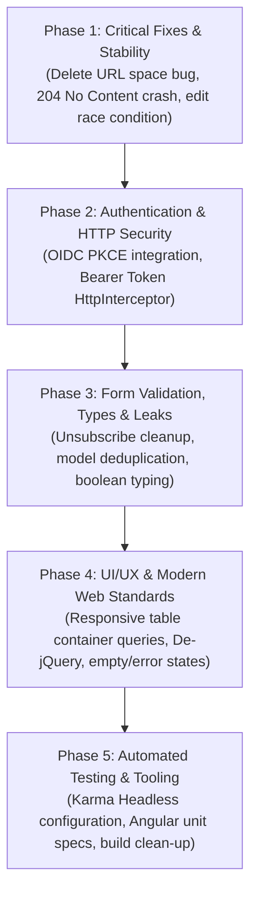

# 2026-10-24 Frontend Remediation Plan

## Summary

This remediation plan addresses the client-side bugs, lack of authentication, security vulnerabilities, architectural debt, and UI/UX limitations identified in the Angular application (`frontend/`). It integrates guidance from **`frontend-design`** for visual hierarchy and copywriting, and **`modern-web-guidance`** for accessible, responsive tables and semantic layout.

---

## Phasing & Dependencies



---

## Phase 1: Critical Runtime Fixes & Stability

### 1.1 Fix Trailing Whitespace in Delete Endpoint
- **Location**: [`film.service.ts`](file:///d:/Projects/RipPerC_backend/frontend/src/app/services/film.service.ts#L20-L22)
- **Defect**: The template `${this.url_films}/${film.id} ` appends a trailing space, requesting `/v1/film/123%20`. Spring Boot rejects this with HTTP 400.
- **Decision & Fix**:
  ```typescript
  deleteFilm(film: Film): Observable<void> {
    return this.http.delete<void>(`${this.url_films}/${film.id}`);
  }
  ```

### 1.2 Handle Empty Catalog (HTTP 204 No Content) Without Crashing
- **Location**: [`films.component.ts`](file:///d:/Projects/RipPerC_backend/frontend/src/app/pages/films/films.component.ts#L40-L45)
- **Defect**: The backend returns HTTP 204 when the film list is empty. Angular `HttpClient` returns `null` for 204 JSON responses. Reading `this.allFilms.length` throws `TypeError: Cannot read properties of null (reading 'length')`.
- **Decision & Fix**: Guard against null payload:
  ```typescript
  this.filmService.loadFilms().subscribe({
    next: (response: Film[] | null) => {
      this.allFilms = response ?? [];
      this.allFilmsAux = this.allFilms;
      this.total = this.allFilms.length;
      this.loading = false;
    },
    error: (err) => {
      this.loading = false;
      this.errorMessage = 'Unable to load films from server.';
    }
  });
  ```

### 1.3 Eliminate Double Call and Race Condition in `editFilm`
- **Location**: [`films.component.ts`](file:///d:/Projects/RipPerC_backend/frontend/src/app/pages/films/films.component.ts#L76-L86)
- **Defect**: `this.loadFilms()` is invoked synchronously right after initiating the HTTP update call, racing the backend and reloading stale data before the update completes.
- **Decision & Fix**: Remove the duplicate outside call and reload only inside the `next` callback:
  ```typescript
  editFilm(film: Film): void {
    this.filmService.updateOrCreateFilm(film).subscribe({
      next: () => {
        Swal.fire({ title: 'Updated!', text: `Film: ${film.title}`, icon: 'success' });
        this.loadFilms();
      },
      error: (err) => {
        Swal.fire({ title: 'Error', text: 'Could not update film.', icon: 'error' });
      }
    });
  }
  ```

---

## Phase 2: Authentication & HTTP Security

### 2.1 OIDC Authorization Code Flow with PKCE
- **Context**: The backend protects `/v1/**` with JWT authentication. Angular is a public client and must never embed client secrets.
- **Decision & Implementation**:
  - Install `angular-oauth2-oidc`.
  - Configure OIDC Auth Code Flow with PKCE:
    ```typescript
    export const authConfig: AuthConfig = {
      issuer: environment.oidc_issuer,
      redirectUri: window.location.origin + '/index.html',
      clientId: 'hdh-frontend',
      responseType: 'code',
      scope: 'openid profile email',
      showDebugInformation: !environment.production,
    };
    ```
  - Implement an `AuthService` handling login, logout, and token refresh.

### 2.2 HTTP Token Interceptor
- **Decision & Implementation**:
  - Create `AuthInterceptor` implementing `HttpInterceptor`.
  - Automatically attach `Authorization: Bearer <access_token>` to all HTTP requests targeting `environment.base_url`.
  - Handle `401 Unauthorized` responses gracefully by redirecting to the login flow rather than silently hanging the UI in a loading state.

---

## Phase 3: Form Validation, Data Typing & Memory Leaks

### 3.1 Model Consolidation & Proper Typing
- **Location**: [`film.model.ts`](file:///d:/Projects/RipPerC_backend/frontend/src/app/pages/model/film.model.ts) and [`film.interface.ts`](file:///d:/Projects/RipPerC_backend/frontend/src/app/interfaces/film.interface.ts)
- **Defect**: Duplicate class and interface with conflicting import locations.
- **Decision & Fix**:
  - Consolidate on a single typed interface `Film` under `src/app/models/film.model.ts`.
  - Ensure all service and component signatures use this shared interface.

### 3.2 Form Validation & Boolean Type Fix in `FilmComponent`
- **Location**: [`film.component.ts`](file:///d:/Projects/RipPerC_backend/frontend/src/app/pages/films/film.component.ts#L30, #L38-L45)
- **Defect**: `downloaded: ['false']` initializes a string instead of a boolean. `saveFilm()` lacks validation guards.
- **Decision & Fix**:
  - Initialize boolean `downloaded: [false, Validators.required]`.
  - Guard submission: `if (this.filmForm.invalid) { this.filmForm.markAllAsTouched(); return; }`.

### 3.3 Memory Leak Prevention
- **Location**: [`films.component.ts`](file:///d:/Projects/RipPerC_backend/frontend/src/app/pages/films/films.component.ts), [`breadcrumbs.component.ts`](file:///d:/Projects/RipPerC_backend/frontend/src/app/shared/breadcrumbs/breadcrumbs.component.ts)
- **Defect**: Subscriptions created on components that are never unsubscribed on destroy.
- **Decision & Fix**: Apply `takeUntil(this.destroy$)` using a `Subject<void>` in `ngOnDestroy()`.

---

## Phase 4: UI/UX & Modern Web Standards Overhaul

Guided by **`frontend-design`** and **`modern-web-guidance`**:

### 4.1 Responsive Semantic Table (`modern-web-guidance: responsive-table`)
- **Location**: [`films.component.html`](file:///d:/Projects/RipPerC_backend/frontend/src/app/pages/films/films.component.html)
- **Defect**: Unresponsive standard table with direct `<input>` tags embedded in every row cell, breaking visual hierarchy and keyboard accessibility.
- **Decision & Implementation**:
  1. **Semantic Container**:
     ```html
     <div tabindex="0" role="region" aria-labelledby="films-heading" class="table-wrapper">
       <table class="film-table">
         <caption id="films-heading" class="sr-only">Catalog of registered films</caption>
         <thead>
           <tr>
             <th scope="col">Year</th>
             <th scope="col">Title</th>
             <th scope="col">Director</th>
             <th scope="col">Format</th>
             <th scope="col">Status</th>
             <th scope="col">Actions</th>
           </tr>
         </thead>
         <tbody>...</tbody>
       </table>
     </div>
     ```
  2. **Sticky Headers**: Apply `position: sticky` to `<thead>` with logical properties (`inset-block-start: 0`).
  3. **Container Query Card Transformation**:
     Using `@container (width < 640px)`, transform table rows into stacked visual cards on narrow viewports, injecting column titles with `::before` pseudo-elements.

### 4.2 Decouple Editing from Table Display
- **Decision**:
  - Replace raw input controls in table cells with readable text and clear action buttons.
  - Implement a dedicated edit flow: navigating to `/tecas/films/:id` or opening an accessible `<dialog>` modal with validation and cancel/save options.

### 4.3 Human-Centered Copywriting & Directional Empty States
- **Guidance from `frontend-design`**:
  - *"Treat failure and emptiness as moments for direction, not mood... An empty screen is an invitation to act."*
  - **Empty Catalog State**: Display an inviting message: *"Your film catalog is empty. Add your first film to start building your collection."* paired with an active primary action button: *"Add new film"*.
  - **Error State**: Inform the user clearly what failed and offer an immediate retry button.
  - **Action Button Labels**: Replace cryptic icons and broken `matTooltip` directives with clear, accessible labels ("Edit film", "Delete film", "Mark as downloaded").

### 4.4 De-jQuery and Script Tag Removal
- **Location**: [`index.html`](file:///d:/Projects/RipPerC_backend/frontend/src/index.html#L64-L78)
- **Defect**: Global script tags loading jQuery, Bootstrap JS, Sparkline, and legacy theme scripts outside of Angular.
- **Decision & Fix**:
  - Remove all legacy `.js` scripts from `index.html`.
  - Use native Angular routing, reactive bindings, and CSS transitions instead of jQuery DOM plugins.

---

## Phase 5: Automated Testing & Tooling

### 5.1 Tooling & Configuration Fixes
- **Location**: [`angular.json`](file:///d:/Projects/RipPerC_backend/frontend/angular.json#L16)
- **Fix**: Correct typo `"allowedCommonJsDependencies": ["sweetalert2"]` (fixing `"sweetaler2"`).

### 5.2 Configure Karma for Headless Multi-Environment Execution
- **Location**: [`karma.conf.js`](file:///d:/Projects/RipPerC_backend/frontend/karma.conf.js)
- **Defect**: Hardcoded Chrome Windows binary path prevents tests from running in CI or environments without default Chrome installs.
- **Decision & Fix**: Configure a portable headless launcher:
  ```javascript
  customLaunchers: {
    ChromeHeadlessNoSandbox: {
      base: 'ChromeHeadless',
      flags: ['--no-sandbox', '--disable-gpu']
    }
  },
  browsers: ['ChromeHeadlessNoSandbox']
  ```

### 5.3 Implement Unit Test Specifications
- Author test suites:
  - `src/app/services/film.service.spec.ts`: Verify API URLs, query parameters, error responses.
  - `src/app/pages/films/films.component.spec.ts`: Verify 204 empty response handling, search filtering logic, sorting toggles.
  - `src/app/pages/films/film.component.spec.ts`: Verify form validation rules and submit guards.
- Validate with:
  ```powershell
  cd frontend; npm.cmd test -- --watch=false
  ```

---

## Acceptance Criteria

- [ ] Delete operation sends requests without trailing whitespace.
- [ ] Catalog renders empty state cleanly on HTTP 204 without TypeError crashes.
- [ ] OIDC PKCE login flow and `AuthInterceptor` attach valid JWT tokens to all `/v1/**` requests.
- [ ] Table is fully responsive with sticky headers and adapts to mobile using container queries.
- [ ] Table cells are clean display elements; editing is handled in a dedicated modal/form.
- [ ] No jQuery or external legacy DOM scripts remain in `index.html`.
- [ ] Unit test specifications exist and pass with `npm test -- --watch=false`.
